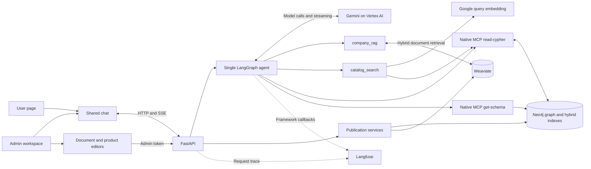
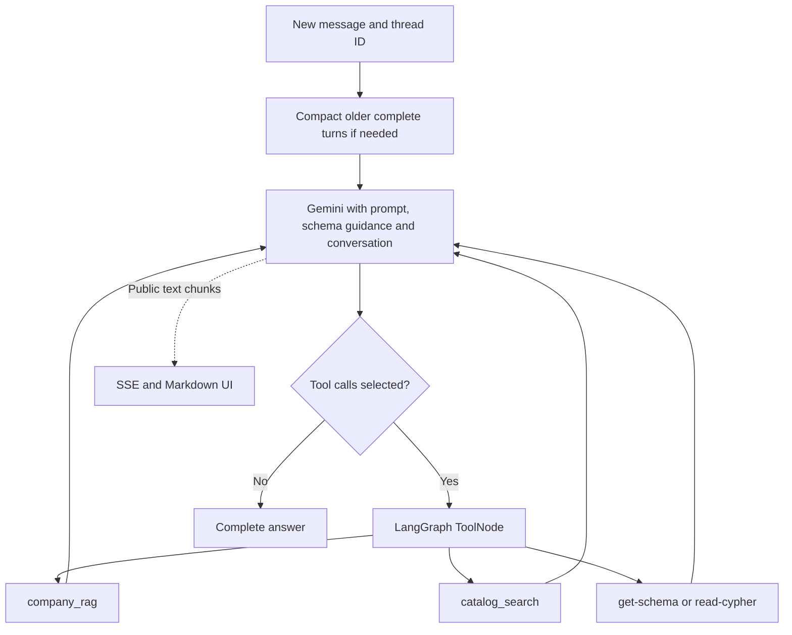

# Attoforce assistant — Company Compass

A company assistant for questions, software recommendations and comparisons.
One Gemini agent uses Weaviate document RAG and a Neo4j product graph, with
streamed Markdown answers, LangGraph memory compaction and Langfuse tracing.
The supplied assignment catalog contains **20 fictional products and 39 plans**.

- `/`: Attoforce-inspired user page with a floating assistant widget.
- `/admin`: document upload/edit/re-ingestion and product/plan administration.
- Python/FastAPI backend and React/TypeScript/Vite frontend.

## Architecture



`catalog_search` runs in Python outside the MCP server. It generates query
embeddings and passes them as parameters to the unchanged native `read-cypher` tool.

## Prerequisites

| Dependency   | Requirement                                                                          |
| ------------ | ------------------------------------------------------------------------------------ |
| Python       | 3.12 or 3.13, matching `>=3.12,<3.14` in pyproject.toml                              |
| uv           | Python environment and locked dependencies                                           |
| Node.js/npm  | Vite requires `^20.19.0` or `>=22.12.0`; Node 24 is suitable                         |
| Google Cloud | Vertex AI, access to the configured models and service-account or ADC credentials    |
| Neo4j        | Aura or a compatible instance with vector/full-text indexes and official MCP support |
| Weaviate     | Cloud cluster/API key; current collection setup uses HFresh indexes                  |
| Langfuse     | Optional project keys for tracing                                                    |

Install [Python](https://www.python.org/downloads/),
[uv](https://docs.astral.sh/uv/getting-started/installation/) and
[Node.js](https://nodejs.org/en/download). Commands below use PowerShell from the
repository root. Two-terminal startup works on macOS/Linux too.

## 1. Install

Clone this repository, open its root directory, then run:

```powershell
uv python install 3.12
uv sync --frozen --extra dev --extra neo4j-mcp --python 3.12
Push-Location frontend
npm ci
Pop-Location
```

`uv.lock` and `frontend/package-lock.json` pin resolved dependencies. The optional
`neo4j-mcp` extra installs the official MCP server used by this backend. Codex MCP
registration and REA are development tooling, not application prerequisites.

## 2. Configure

```powershell
Copy-Item .env.example .env
(Resolve-Path .venv/Scripts/neo4j-mcp-server.exe).Path
```

Do not overwrite an existing configured `.env`. Put the printed absolute path in
`NEO4J_MCP_COMMAND`. On macOS/Linux resolve `.venv/bin/neo4j-mcp-server` instead.
Keep `NEO4J_MCP_ARGS=[]`; the backend supplies Neo4j credentials/read-only settings.

Edit `.env` with your own values:

| Setting                                         | Cloud setup                                                              |
| ----------------------------------------------- | ------------------------------------------------------------------------ |
| `APP_MODE`                                      | `cloud`; the example defaults to `local`                                 |
| `ADMIN_TOKEN`                                   | Long random token used when publishing in the admin UI                   |
| `GOOGLE_CLOUD_PROJECT`                          | Your Vertex AI project ID                                                |
| `GOOGLE_APPLICATION_CREDENTIALS`                | Absolute service-account JSON path, or blank for ADC                     |
| `GEMINI_USE_VERTEXAI` / `GEMINI_THINKING_LEVEL` | `true` / `medium`                                                        |
| `LLM_MODEL`                                     | Model enabled for your project; assignment default is `gemini-3.8-flash` |
| `GOOGLE_CLOUD_LOCATION`                         | `global` for the configured assignment chat model                        |
| `GOOGLE_EMBEDDING_LOCATION`                     | `us-central1` for the configured embedding model                         |
| `EMBEDDING_PROVIDER` / `EMBEDDING_MODEL`        | `vertex` / `gemini-embedding-001`                                        |
| `EMBEDDING_DIMENSIONS`                          | `1536`                                                                   |
| `NEO4J_URI`, `NEO4J_USERNAME`, `NEO4J_PASSWORD` | Your instance connection details                                         |
| `NEO4J_DATABASE`                                | Actual database name from your instance                                  |
| `NEO4J_MCP_COMMAND`                             | Absolute executable path resolved above                                  |
| `WEAVIATE_URL`, `WEAVIATE_API_KEY`              | Cloud endpoint and key                                                   |
| `WEAVIATE_COLLECTION`, `WEAVIATE_VECTOR_NAME`   | `CompanyChunk`, `google_1536` for a new setup                            |
| `COMPANY_DOMAIN`                                | `attoforce.ai` for approved company URL ingestion                        |

Grant the Google identity permission to invoke the configured models. For ADC,
leave the JSON path blank and authenticate with the Google Cloud CLI:

```powershell
gcloud auth application-default login
```

Model access/locations depend on your project; the selected chat model must support
the configured reasoning setting. Embeddings always use Vertex AI in this setup,
even if chat is changed to API-key authentication. Never commit `.env`, keys or
service-account JSON. More details: [configuration and troubleshooting](docs/setup.md).

## 3. Populate and index

Run in this order after configuring cloud credentials:

```powershell
uv run company-compass check
uv run company-compass seed
uv run company-compass index-catalog
uv run company-compass ingest https://attoforce.ai/
uv run company-compass mcp-check
```

| Command         | Behavior                                                                                   |
| --------------- | ------------------------------------------------------------------------------------------ |
| `check`         | Catalog connectivity and Weaviate readiness; does not seed or verify model inference       |
| `seed`          | Creates catalog constraints and adds missing fictional products, preserving existing edits |
| `index-catalog` | Creates vector/full-text indexes and embeds current product descriptions/use cases         |
| `ingest`        | Extracts approved HTML, embeds chunks and publishes the document manifest                  |
| `mcp-check`     | Verifies native schema/read tools without a model call                                     |

Inspect results and warnings. First ingestion creates the Weaviate collection/named
vector if missing, so its key needs setup/write permissions. Cloud publication,
indexing and ingestion invoke Google embeddings; provider charges may apply.

Catalog backfill is explicit, not startup work; rerunning regenerates vectors.
Admin product saves subsequently update embeddings with publication. An embedding
failure leaves the previous product intact. Preserve `data/runtime/knowledge.json`:
the document manifest selects active cloud content versions. For existing embedding
data, follow [migration guidance](docs/setup.md#existing-data-and-embedding-changes).

## 4. Start

Run from the repository root. Start both services with the Windows script
(works from Command Prompt or PowerShell):

```powershell
powershell.exe -NoProfile -ExecutionPolicy Bypass -File ".\scripts\start-dev.ps1"
```

It starts missing services in hidden processes and logs under `data/runtime/`.
It leaves healthy processes running. Restart the backend after Python or `.env`
changes; running the launcher again does not reload an existing healthy backend.

Or start the backend and frontend separately in two terminals:

```powershell
# Terminal 1: repository root
uv run python -m company_compass.cli serve --port 8010
```

```powershell
# Terminal 2: repository root
cd frontend
npm run dev -- --port 5173 --strictPort
```

- User page: http://127.0.0.1:5173/
- Admin: http://127.0.0.1:5173/admin
- API docs: http://127.0.0.1:8010/docs
- Health: http://127.0.0.1:8010/api/health

Health reports process/configuration status, not every provider's readiness. Test
a real chat to verify inference and retrieval. Vite proxies `/api` to 8010.
Production hosting needs API routing and an SPA fallback to `index.html` for `/admin`.

## Agent workflow and four tools

| Tool             | Purpose                                                                                  |
| ---------------- | ---------------------------------------------------------------------------------------- |
| `get-schema`     | Native MCP: node labels, property types and relationship directions, not product records |
| `read-cypher`    | Native MCP: factual queries and multi-hop graph traversal                                |
| `company_rag`    | Python: hybrid retrieval from active Weaviate document versions                          |
| `catalog_search` | Python: embeddings, Neo4j hybrid search and top-five product relationship context        |



For document automation, Python embeds the requirement, passes its 1536-number
vector to MCP, fuses vector/keyword rankings and traverses five current products
into plans, capabilities, use cases, prices and typed attributes. The model receives
facts, not vectors, and can call tools again. No separate intent router is required.

Search relevance is not eligibility: the agent checks hard constraints and can
query beyond five candidates. Exact latest-revision lookups use Cypher. Historical
revisions are stored, but the current prompt prioritizes current publications;
historical-answer behavior is not yet verified. See [hybrid retrieval](docs/catalog-hybrid-search.md).

## Admin and tracing

Documents supports IDs/titles, full content, TXT/MD/PDF/DOCX uploads and replacement
ingestion. Products supports in-place Edit/Save/Cancel and adding products/plans.
Writes require `ADMIN_TOKEN`; chat cannot publish. Revision conflicts preserve drafts.

For optional tracing, configure `LANGFUSE_PUBLIC_KEY`, `LANGFUSE_SECRET_KEY`,
`LANGFUSE_BASE_URL` and `LANGFUSE_ENABLED=true`. Each turn has one trace; thread IDs
group turns into sessions. Native callbacks capture model/tool/compaction activity.
Content capture defaults off. Enable `LANGFUSE_CAPTURE_CONTENT=true` only for data
appropriate to export; masking is not comprehensive confidential-data classification.

## Production readiness and guardrails

This repository is a working assignment, **not yet a production-ready service**.
Existing controls include read-only MCP tools, protected admin writes, typed/bounded
inputs, revision checks, safe Markdown, trace masking and a bounded graph loop.
Prompt rules guide grounding and untrusted-content handling; they are not executable
authorization or proof that every generated recommendation is correct.

Before production, add identity/RBAC, independently enforced dataset isolation,
per-call query/tool policies, input/output and sensitive-data guardrails, factual
recommendation validation, guarded streaming, rate/concurrency/cost budgets,
durable state, monitored readiness and CI security checks. Each needs measured
acceptance evidence. See the [production readiness and guardrail plan](docs/production-readiness-plan.md).

Real environment files, credentials, private keys and runtime logs are ignored.
Only the root `.env.example` is tracked as a secret-free template. Use deployment
secret storage/workload identity for production; `.gitignore` does not remove
previously tracked secrets. Editor/line-ending conventions are in `.editorconfig`
and `.gitattributes`; Ruff and Prettier remain the code-formatting authorities.

## Local mode and limitations

For UI/admin exploration without cloud stores, use `APP_MODE=local`, leave
`NEO4J_MCP_COMMAND` blank and run `uv run company-compass seed --local`. Products
use local JSON and document retrieval is lexical. This does not provide Neo4j
hybrid product discovery. Chat still needs a real configured model.

Memory resets on backend restart. Minimizing the widget preserves its conversation;
full-page navigation creates a fresh client conversation. No web search, DRIFT,
structural embeddings, OCR, background indexing queue or persistent chat database
is included. The admin token is not a user-login or multi-tenant identity system.

## Code and verification

```text
src/company_compass/
  main.py, cli.py          API composition and explicit setup/run commands
  agents/                 Workflow, streaming ownership, memory and prompt
  api/, core/, models/    Routes, authorization, settings and contracts
  integrations/           Gemini, embeddings, native MCP, tools and Langfuse
  repositories/           Atomic catalog revision publication
  services/               Catalog search and document ingestion/retrieval
  utils/                  Extraction, seed data and storage helpers
frontend/src/
  Application.tsx         Public/admin page selection
  features/               Public page, shared chat, Documents and Products
  services/, models/      HTTP/SSE client and API contracts
docs/                     Setup, architecture, schema and verification
```

```powershell
uv run pytest -q
uv run ruff check src tests
uv run ruff format --check src tests
Push-Location frontend
npm test
npm run build
npm run format:check
Pop-Location
```

Recorded verification: 161 backend tests, 32 frontend tests, build/lint/format and
live MCP/streaming checks. These are recorded results, not a retrieval-quality
benchmark. See [verification](docs/verification.md).

## Documentation

- [Setup and troubleshooting](docs/setup.md)
- [Production readiness and guardrail plan](docs/production-readiness-plan.md)
- [Implemented architecture](docs/implementation-architecture.md)
- [Mermaid system, sequence, schema and tracing diagrams](docs/architecture-diagrams.md)
- [Catalog hybrid search](docs/catalog-hybrid-search.md)
- [Neo4j walkthrough](docs/neo4j-guide.md) and [query schema](docs/knowledge/catalog/schema.md)
- [Document/admin workflows](docs/document-management.md)
- [Requirements](docs/requirements.md) and [decision history](docs/discussion-log.md)
