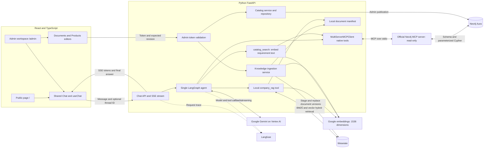
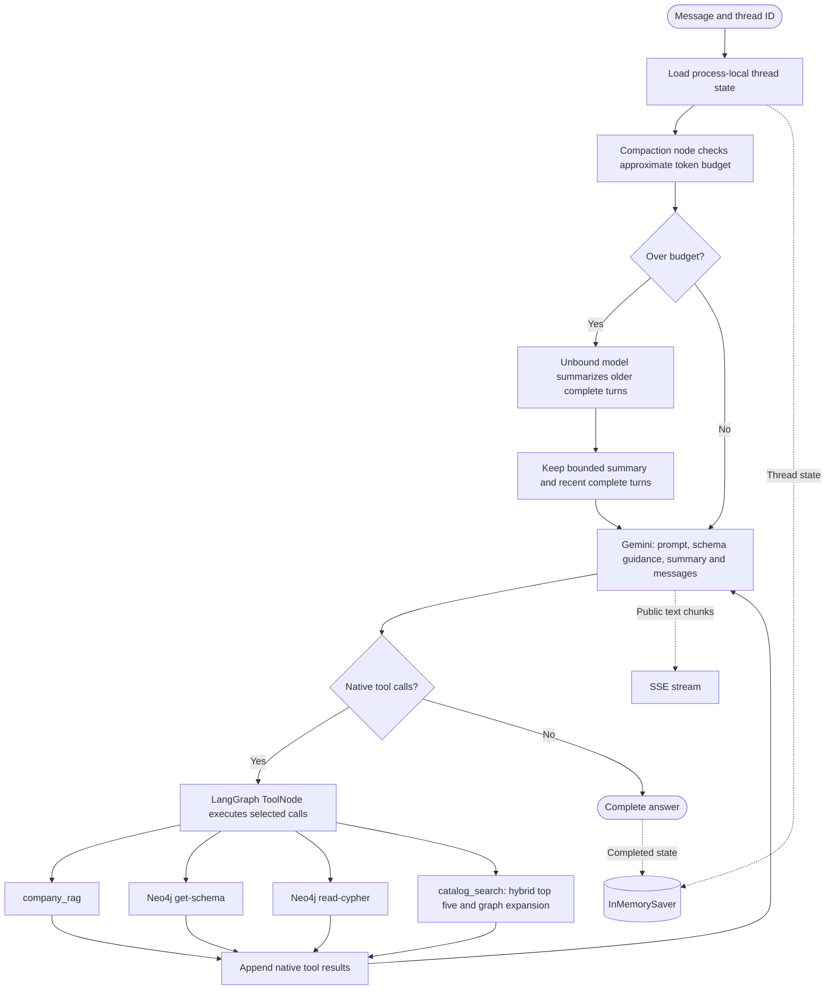
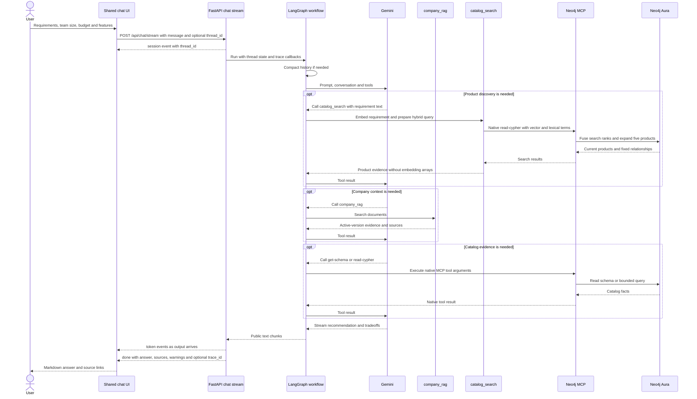
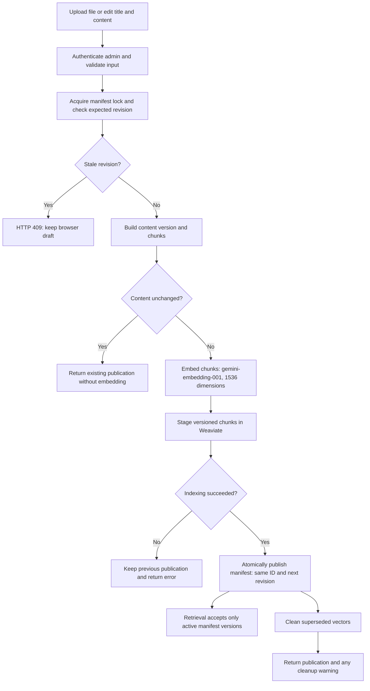
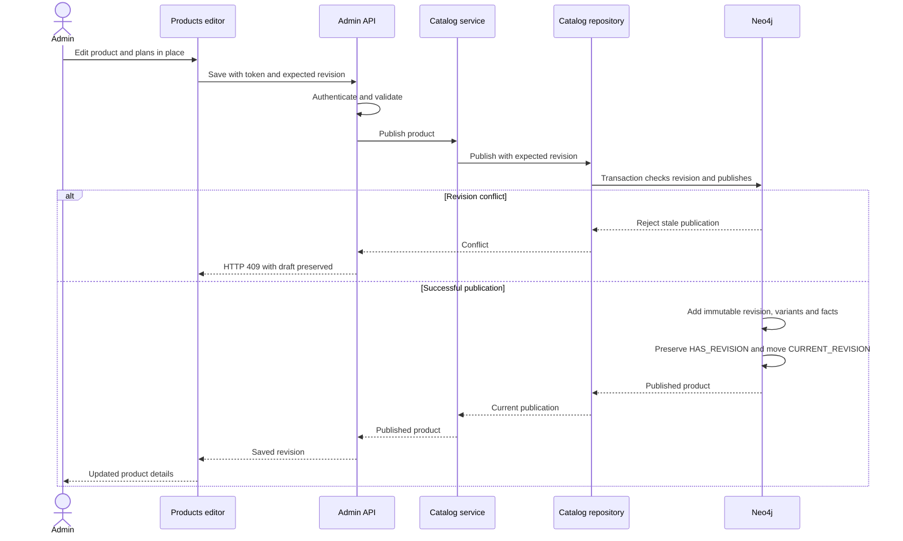
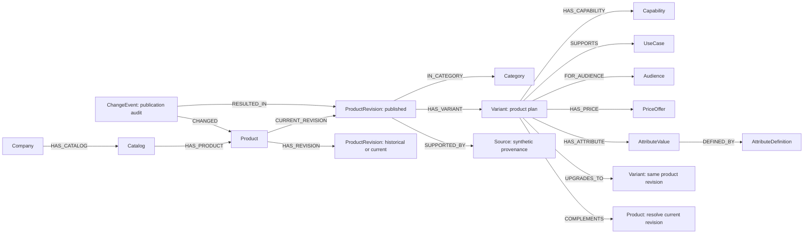
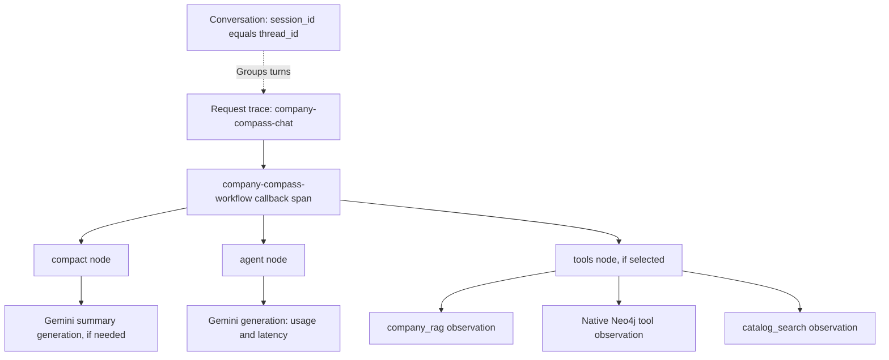

# Attoforce assistant: architecture diagrams

These charts describe the implemented cloud-mode architecture. The catalog is
synthetic; local-mode storage substitutes are omitted for readability. No web
search, clustering service, DRIFT search or separate recommendation engine is present.

## 1. System architecture

Both pages reuse the same chat implementation. Admin writes use authenticated API
endpoints, separate from the agent's read-only tools.

Code: [page selection](../frontend/src/Application.tsx),
[workflow](../src/company_compass/agents/workflow.py),
[services](../src/company_compass/services),
[integrations](../src/company_compass/integrations).

## 2. Agent orchestration and memory

The model chooses tools using the system prompt and schema guidance. The four
callable functions come from two integrations: company RAG and Neo4j MCP.

There is no fixed intent router or mandatory product preload. The graph has a
recursion limit; same-thread turns are serialized. Memory resets on backend
restart. Internal summary output is not streamed. Failed/cancelled turns restore
the preceding completed state. See [memory details](implementation-architecture.md#memory-and-compaction).

## 3. Streaming recommendation sequence

This is an example of model-selected calls, not a mandatory tool order. The agent
can clarify requirements, skip tools, or call either integration repeatedly.

The browser sends only the next message and thread ID. Minimizing keeps Chat
mounted; New chat cancels the active request and resets client state. Full-page
navigation starts a fresh client conversation. Errors retain partial output and
display an error. Compaction is internal; only public model text is streamed.

## 4. Human-maintained document pipeline

The document ID survives replacement. The manifest determines which indexed
content version retrieval can use. Publication is synchronous and single-host.

Supported uploads are TXT, Markdown, text PDF and DOCX; OCR is not implemented.
Official URL refresh skips admin-edited documents. Failed cleanup cannot undo a
successful replacement. See [document management](document-management.md).

## 5. Human-maintained product publication

Admin publication uses the application's write connection, separate from read-only
MCP. Historical product revisions remain in Neo4j.

## 6. Catalog graph for recommendations

These are Neo4j node labels and relationship types. Recommendations follow
`CURRENT_REVISION`; `HAS_REVISION` also reaches historical publications.

Catalog discovery embeds descriptions/use cases and fuses vector/full-text ranks
into five current products with relationship context. See the [hybrid pipeline](catalog-hybrid-search.md).
The model queries task fit, included capabilities, capacity and comparable price
units, then explains evidence and tradeoffs. Similarity comes from shared facts,
not a stored SIMILAR_TO relationship. Prices use integer minor units; unknown
mandatory attributes cannot establish eligibility. See [query schema](knowledge/catalog/schema.md)
and [Neo4j guide](neo4j-guide.md).

## 7. Observability structure

Each HTTP turn creates one trace. Turns in a conversation share a Langfuse session
ID. Native framework callbacks attach under the request observation.

Trace names retain the internal project identifier. Visible chat branding is
**Attoforce assistant**. Content export follows configured masking; credentials
and internal reasoning are excluded from public output. See [observability code](../src/company_compass/integrations/observability.py).
