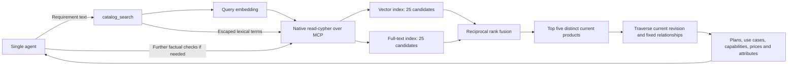

# Catalog hybrid search

The agent uses `catalog_search(query)` to discover up to five relevant products.
This remains one agent with two data integrations: company documents and Neo4j.
Native `get-schema` and `read-cypher` tools are still passed through unchanged.
There is no automatic retrieval before the agent receives the user's message.

## Searchable content and publication

Each stable `Product` stores `search_text`, `search_embedding`, `search_model` and
`search_dimensions`. Text contains its name, description and the union of product
and plan use cases. Use-case underscores become spaces. Prices and numeric limits
are excluded from embeddings and remain structured facts.

Google `gemini-embedding-001` generates normalized 1536-dimensional document/query
vectors with the appropriate retrieval task types. The application, not the LLM,
generates query vectors. Indexes are:

| Index | Property | Purpose |
| --- | --- | --- |
| `catalog_product_vector` | `Product.search_embedding` | Cosine semantic retrieval |
| `catalog_product_fulltext` | `Product.search_text` | Lexical retrieval |

Product publication prepares the embedding before the database transaction, then
updates the current revision and search properties in the same transaction. An
embedding failure prevents publication. Retirement removes search properties.
Backfill locks the same catalog counter as publication and rechecks the expected
revision before writing vectors, avoiding stale embeddings over concurrent edits.
Backfill changes search metadata, not historical product revisions.

## Retrieval and graph expansion



Each source ranks matches independently. Equal-weight reciprocal rank fusion uses
constant 60; raw cosine and full-text scores are not added. Dataset, active status,
current published revision, embedding model and dimensions are checked before
fusion. Ties use product ID. Only five distinct products are returned, or fewer
when fewer valid candidates are available.

The query traverses categories and current variants to project use cases,
capabilities/availability, audiences, prices/billing units, typed attributes,
upgrades and complements. It also returns the current product DTO. Vectors and raw
Neo4j nodes are excluded from agent evidence. Native MCP failures are explicit
errors, not successful empty searches. Lucene operators in user text are not
executed as an authored search expression.

## Relevance and eligibility

The five hits are discovery candidates, not five guaranteed eligible recommendations.
The agent checks plan-specific requirements and uses native Cypher for deeper
comparisons or additional constraint-based retrieval. It must not claim no eligible
product exists merely because the five semantic matches fail a constraint.

Source lists are bounded at 25 before eligibility/model filtering; incompatible or
inactive externally indexed nodes can reduce recall. Indexes here are intended for
the assignment's one catalog/model. Multi-tenant/model index isolation and retrieval
evaluation at larger scale remain future work. No recall benchmark is claimed.

## Setup and verification

The two index names are application-owned. Setup checks vector dimensions but
does not repair same-name indexes created externally on other labels/properties
or with a different similarity function. Verify such external indexes before reuse.

```powershell
uv run company-compass index-catalog
```

This cloud-only command creates indexes idempotently, checks dimensions, waits for
index readiness and embeds current products. It preserves document data and product
revision history. Rerunning backfill regenerates embeddings; it is an explicit setup
operation, not startup work. A different embedding model requires reindexing even
when dimensions are unchanged. A dimension change requires explicit index migration.

Reference: [Neo4j hybrid search](https://neo4j.com/developer/genai-ecosystem/hybrid-search/).
This implementation uses the guide's procedure-compatible query form; newer
Neo4j releases also support `SEARCH`. See [verification](verification.md) for actual
test and live-check evidence.
