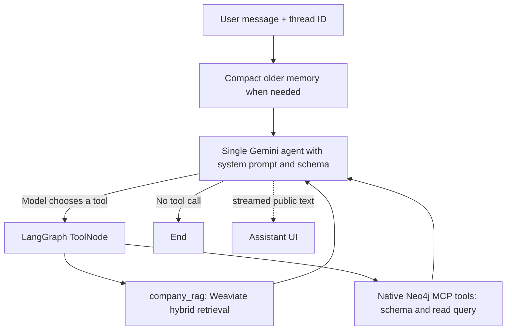

# Implemented architecture

## Agent workflow



`agents/workflow.py` defines the graph. `MessagesState`/`add_messages` preserve native
AI/tool messages, including Gemini tool signatures. Conditional edges inspect actual
model tool calls; there is no intent classifier, mandatory product preload or fixed
retrieval order. The prompt guides requirements discovery, catalog inspection,
constraint-aware Cypher, relationships, comparisons and evidence-based answers.
A greeting can finish without a tool; an investigation can make successive calls.

`integrations/agent_tools.py` creates one unified tool list:

```python
mcp_tools = await load_neo4j_tools(settings)  # MultiServerMCPClient.get_tools()
all_tools = [*mcp_tools, company_rag]
```

The native get-schema/read-cypher tool objects,argument schemas and executors are
passed intact to one agent. There is no application-authored neo4j_query wrapper,
JSON-parameter shim,query parser or custom low-level MCP session implementation.
The Neo4j server is configured read-only and exposes only those two MCP tools.
There are three callable functions from two integrations: MCP and company RAG.
The model uses read-cypher's native params object and explicitly supplies the
catalog dataset. Authored schema/prompt instructions scope current published data;
query scope,parameters and recommendation fit are no longer application-injected.

ServiceContainer.initialize() awaits discovery during FastAPI lifespan,merges the
local RAG tool,and compiles the graph once before serving requests. It is idempotent.
Discovery uses adapter0.3.2's get_tools(),not an unsupported async client context
manager. Per-call MCP sessions are managed by the adapter. Discovery failure is
reported at startup rather than silently replacing catalog access. No configured
MCP command yields only local RAG; the prompt reports catalog access as unavailable.
The obsolete custom client and query-wrapper tests were replaced by native object/
schema identity,real local stdio discovery/invocation and startup-binding tests.

## Memory and compaction

The compiled graph uses `InMemorySaver` with a UUID `thread_id`. The browser sends
only the new message and thread ID, avoiding duplicate history replay. Same-thread
turns are serialized. New chat generates a new thread; all memory resets on restart.

Before the agent step, approximate token count triggers summary compaction.
`memory.py` uses the unbound model to summarize older complete turns, preserving
requirements, preferences, selected products and unresolved questions. `RemoveMessage`
removes summarized messages while retaining recent complete turns, so tool calls
and results remain paired. Summary text is bounded and is conversation data, not
new authority. Internal summary output/reasoning is never streamed. Completed state
replaces old checkpoint history; failure/cancellation restores the preceding
completed state. Old separate threads remain in process memory for this assignment.

Defaults: `MEMORY_TOKEN_LIMIT=6000`, `MEMORY_KEEP_MESSAGES=6`,
`AGENT_RECURSION_LIMIT=16`. Approximate counts are trigger heuristics, not provider
usage accounting. Summary compaction can lose details; it is not archival storage.

## Streaming

POST `/api/chat/stream` accepts `{message, thread_id?}` and emits SSE JSON events:
`session`, `token`, `tool`, `done`, `error`. Text chunks come from the model stream,
not a completed answer split afterward. Tool events contain names/status only.
`done` includes the final answer, thread ID, document sources and warnings.
The frontend handles split UTF-8/SSE frames, cancellation, partial answers and new chat.
The non-streaming `/api/chat` endpoint collects this same workflow for scripts.

## Admin workflows

The UI has Assistant, Documents, Products. Document and product writes use the admin
HTTP endpoints, never chat tools. Documents stage embeddings before publishing a
new manifest revision. Products publish immutable revisions and point
CURRENT_REVISION at the latest publication. Stale edits fail with409.
See [document management](document-management.md) and [schema](knowledge/catalog/schema.md).
The catalog admin service only lists, reads and publishes records; recommendations
query Neo4j MCP directly.

## Providers and files

Gemini uses `langchain-google-genai` with Vertex service-account/ADC authentication,
medium reasoning and native tool calling/streaming. Google Embedding 001 supplies
normalized 1536-dimensional vectors to the Weaviate `google_1536` named vector.
Hybrid retrieval uses BM25+dense search and active document versions. The existing
Free collection required HFresh; the older default vector is retained.

`main.py` wires routes; `core` owns settings/resources; `models` contains contracts;
`repositories` owns persistence; `services` owns admin/domain operations;
`integrations` owns providers/MCP; `utils` contains bounded extraction/storage helpers.
Secrets stay in ignored local configuration. No web-search adapter or application
MCP query wrapper remains. Official schema diagnostics are authenticated and separate
from the model's two tools.

Implementation references:
[LangGraph memory](https://docs.langchain.com/oss/python/langgraph/add-memory),
[streaming](https://docs.langchain.com/oss/python/langgraph/streaming),
[Gemini integration](https://docs.langchain.com/oss/python/integrations/chat/google_generative_ai).
These sources guide the implementation; actual checks are in [verification](verification.md).

## Observability and answer rendering

integrations/observability.py creates an optional Langfuse client after settings
are loaded, then a fresh native LangChain CallbackHandler per turn. An outer HTTP
request span and one workflow callback preserve parent-child relationships without
duplicating generations. Every actual model call, including internal compaction,
is observable. The thread ID is propagated to both request and callback spans as
session context. Callback configuration only reaches graph execution, not
checkpoint rewrites. The final payload may include trace_id for correlation.

trace_masking.py handles SDK input/output masking and export-stage OpenTelemetry
masking. Content capture defaults off; enabled demo capture redacts configured
secrets, credential fields, emails, private keys and internal reasoning/signatures.
Provider usage buckets are preserved rather than estimated or re-created. Native
LangChain/Gemini usage includes cached and reasoning subsets; live auditing checks
exclusive buckets against provider totals. Unknown usage/cost remains unknown.
Request spans end on success/error/cancellation. SDK shutdown/export runs off the
async request loop. No manual generation tracer wraps the framework integration.

The frontend uses react-markdown10.1 and remark-gfm4 for assistant text, reparsing
incremental streaming content. Tables/code scroll within the answer. Raw HTML,
unsafe URL protocols and remote image loading are disabled. User text remains
literal. These rendering changes do not alter the unified single-agent orchestration.

Sources: [Langfuse integration](https://langfuse.com/integrations/frameworks/langchain),
[trace best practices](https://langfuse.com/docs/observability/best-practices),
[export masking](https://langfuse.com/docs/observability/features/masking).
