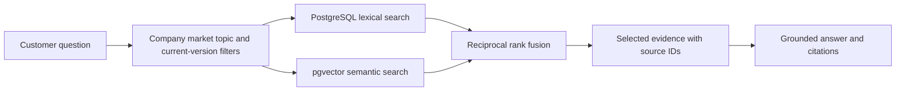

# Fixed-company ingestion and hybrid RAG

Updated: 2026-10-31. Design proposal incorporating the user's confirmed fixed-company scope and requested daily ingestion direction. No services or schedules have been provisioned.

## Perplexity analogy

Perplexity documents both background crawling/indexing and user-triggered page visits. Its Pro Search documentation describes searching sources, synthesizing information, and linking evidence. The reviewed documentation does not establish its internal vector database architecture. Our design can adopt evidence-backed search and answers without asserting that Perplexity is simply a vector database pipeline.

Sources: [Perplexity crawlers](https://docs.perplexity.ai/docs/resources/perplexity-crawlers), [Pro Search](https://www.perplexity.ai/help-center/en/articles/10352903-what-is-pro-search).

## Existing scraper MCP candidate

Propose Firecrawl MCP for web discovery and page extraction. Its [official MCP documentation](https://docs.firecrawl.dev/mcp-server) supports search/scrape access and authenticated connections. Tool availability depends on endpoint, authentication, and plan; discover actual tools and validate schemas during the spike. Do not assume all crawl/map features are available on a minimal endpoint.

Firecrawl's [change tracking](https://docs.firecrawl.dev/features/change-tracking) can compare page versions. Treat that as an optional optimization after confirming that the chosen MCP scrape tool exposes the required options. Application-level normalized content hashes provide a provider-independent baseline.

MCP exposes callable operations. The ingestion worker owns scheduling, validation, deduplication, indexing, and publication. The MCP server does not by itself constitute the complete ingestion pipeline.

## Initial ingestion

1. Create a company/market profile and approved source registry: official overview, FAQ, policies, product categories, product pages, newsroom, feeds, and sitemaps as available.
2. Discover URLs within domain/path, page-count, and cost limits.
3. Call the scraper MCP tools to fetch readable content and source metadata. Search snippets alone are insufficient evidence for stored facts.
4. Store fetched snapshots for debugging and reprocessing, with access and retention appropriate to source permissions. Keep snapshots outside the Git repository; keep source configuration and dataset manifests in Git.
5. Normalize URLs and content; remove navigation duplication; identify topic, company relevance, market, and source class.
6. Extract structured catalog records from authoritative product sources; validate identifiers, currencies, units, and required attributes.
7. Chunk company content by headings, compute embeddings, and build lexical indexes.
8. Publish validated document versions and catalog changes; record run results and dataset version.

## Daily refresh

Use an external scheduler to invoke a repeatable ingestion command once daily; deployment determines the scheduler implementation. Select the time and timezone later. A deterministic worker can call MCP tools without an LLM deciding whether to run the daily job.

Each run has two discovery paths:

- **Refresh known pages:** revisit current policy, company, and catalog URLs, including pages whose URL never changes. Feeds/sitemap modification times can prioritize work, but are not conclusive evidence of no change.
- **Discover new pages:** inspect official newsroom/feed/sitemap/category changes and search for recent company updates. Use an overlap window around the last successful discovery time to tolerate indexing delays; deduplicate by canonical URL and content hash. Search date filters cannot guarantee complete coverage.

After discovery, fetch pages, detect changes, validate, stage, index, and publish. Reuse embeddings for unchanged chunks. When a page changes, publish the new version and supersede its old chunks together so current answers do not mix versions. Keep separate publication time and observation time; a page fetched today may describe an old event.

Product pages follow the same daily refresh but write validated structured records as well as descriptive text. News about a product does not directly overwrite official catalog prices or specifications.

## Source policy

Start with official company sources as authoritative for policies and catalog facts. Selected reputable third-party reporting can be a separate, labeled news collection if useful for company updates. Automatically publish relevant validated changes from approved sources; quarantine unknown sources and extraction/conflict failures for review. Do not ingest arbitrary search hits merely because they mention the company.

Filter retrieval by market, source class, document status, and question intent. Historical news is valid historical evidence, but it cannot silently replace a current policy. Unresolved source disagreements must be visible in the answer or routed to review.

## Reliability and freshness

- Track run ID, source, attempt, fetched/changed/failed counts, publication status, discovery watermark, duration, and provider usage.
- Make upserts idempotent and prevent overlapping runs from publishing conflicting versions.
- Retry transient failures with bounded backoff. Preserve per-source progress and retry failed sources; advance watermarks only for successful work.
- Keep the last published version when fetch, parse, embedding, or indexing fails. Show its observation timestamp and stale status; alert the operator when repeated failures or missed runs exceed the agreed freshness window.
- Distinguish a timeout/403 from a removed page. Confirm removals before retiring content; mark discontinued products inactive when supported by evidence. Retain provenance and history for audit.
- Use transaction/version boundaries so a failed refresh does not partially replace a published document and its chunks.
- Daily scheduling targets freshness, not real-time correctness or complete web coverage. Prices and stock may need an authorized live check if the product requirements demand it.

## Query-time hybrid retrieval

### Is a vector database required?

No. RAG requires retrieving relevant evidence; embeddings and vector storage are optional techniques. A valid initial design is scraped documents in PostgreSQL, full-text retrieval for company questions, and structured catalog queries for recommendations. Add embeddings if evaluation demonstrates a need for better semantic matching. PostgreSQL with pgvector can then provide vector search in the same database; a separate dedicated vector database is not required. Lexical-plus-vector hybrid retrieval specifically requires a vector-search capability, but the overall assistant does not.

The user asked whether a vector database is needed; this is a clarification, not a decision to remove vector search. The existing pgvector proposal remains provisional.

Status: recommended candidate, not a prerequisite. The user asked whether hybrid retrieval is necessary. A small, well-structured corpus may perform adequately with vector retrieval and metadata filters. Being a fixed-company assistant or refreshing daily does not itself require hybrid search.

The reason to evaluate hybrid here is the mixture of conversational questions and precise company/product terminology. A customer may paraphrase a policy, mention an exact product name, or ask about a particular guarantee. Lexical and vector retrieval can complement each other, but the benefit is dataset-dependent. Use direct structured lookups for product IDs; full-text tokenization is not a guarantee of exact identifier matching. Numeric constraints such as budget belong in database filters.

Recommended implementation sequence: establish a vector-plus-metadata baseline; compare a lexical-plus-vector variant on the same labeled queries and corpus. Evaluate evidence recall at the same result limit, supported answers, latency, and cost. Keep hybrid if it resolves meaningful failures within the agreed budgets. Do not add a separate search service or reranker before evidence warrants one. PostgreSQL full-text search and pgvector can share the proposed database.

Daily ingestion determines which facts are current. Retrieval determines which indexed facts reach the answer. Hybrid retrieval does not fix stale, conflicting, or missing source data.

Lexical retrieval helps exact names, identifiers, and policy terminology. Vector retrieval helps paraphrases. Reciprocal rank fusion combines rankings without assuming that lexical and vector scores share a scale. Measure evidence recall and answer support before adding a reranker. A query-time live web fallback is optional additional scope and must be labeled separately from indexed knowledge.

## Product recommendation path

Interpret the task as recommending the chosen company's offerings. Retrieve descriptions for relevance, but enforce budget and other hard constraints using normalized catalog fields. Then rank eligible products and explain evidence-backed matches and tradeoffs. Maintain official product links and observation timestamps. Do not let third-party news or generated prose invent product availability.

## Knowledge management surface

A minimal operator workflow should expose approved sources, last successful refresh, ingestion failures, document/product version history, quarantined items, manual refresh/retry, and retirement of invalid sources. Start with a CLI and run reports if a management UI does not fit the deadline. A full document editor, approval organization, and role system are separate scope decisions.

## Validation scenarios

Test a new page, unchanged page, revised policy, duplicate URL, changed product price, removed product, malformed extraction, source conflict, delayed discovery, failed embedding, missed daily run, and safe replay after partial failure. Confirm that no obsolete chunks remain active after publication and that failed refreshes do not remove valid published evidence.
