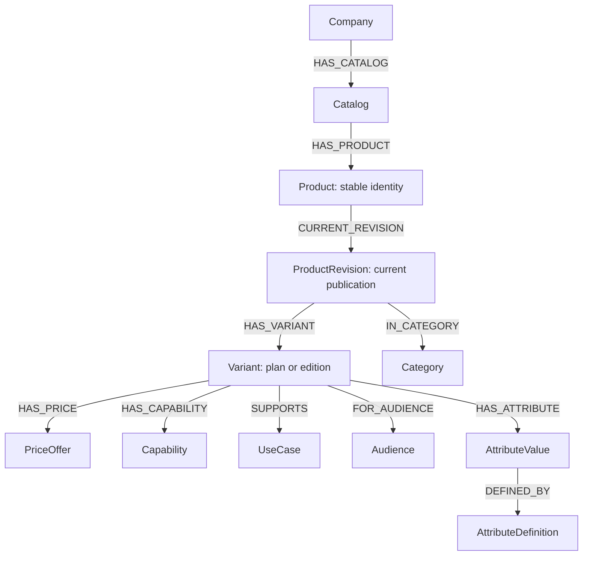

# Understanding the implemented Neo4j catalog

Verified against repository writes and live MCP get-schema/read-cypher on 2026-10-31.
The catalog has 20 active products and 39 current plans. All are fictional demo data.

## Basic graph concepts

A node represents an entity; its label identifies its kind, such as Product or
Variant. Properties hold facts such as id, max_users and amount_minor. A directed
relationship connects entities, such as Variant-HAS_PRICE->PriceOffer. Relationships
can also have properties: HAS_CAPABILITY has availability='included'.

## Main shape



## Nodes and responsibility

| Node | Responsibility | Important fields |
| --- | --- | --- |
| Company | Company anchor; currently Attoforce | id |
| Catalog | Dataset boundary and publication counter | dataset_id, catalog_version, ontology_version, is_synthetic |
| Product | Stable identity across edits | id, storage_key, dataset_id, status, is_synthetic |
| ProductRevision | Published product description and immutable snapshot | revision_id, revision_number, name, description, status, published_at, snapshot_json |
| Variant | A plan/edition belonging to one publication | variant_node_id, variant_id, name, max_users |
| Category | Broad classification/navigation | name, dataset_id |
| UseCase | Actual task supported by a plan | name, dataset_id |
| Capability | Included feature | name, dataset_id |
| Audience | Intended user segment | name, dataset_id |
| PriceOffer | Price and comparable billing basis | offer_id, amount_minor, currency, billing_period, billing_unit, price_type, observed_at |
| AttributeDefinition | Specification meaning, type, unit and comparison rule | code, data_type, canonical_unit, comparison_rule, semantic_version, dataset_id |
| AttributeValue | A plan's typed specification value | attribute_value_id, text_value/integer_value/number_value, value_state, unit |
| Source | Provenance; currently synthetic_admin | source_id, source_kind, label |
| ChangeEvent | Admin publication audit | event_id, action, actor_id, timestamp, catalog_version |

Company currently stores only its identifier. Real company descriptions, publishing
policies and other uploaded documents are retrieved from Weaviate, not these nodes.

## Why Product, ProductRevision and Variant are separate

Product is stable: SalesFlow remains id='salesflow' across edits. ProductRevision
contains one published configuration. Its Variant nodes contain the plans belonging
to that configuration. Prices/features attach to plans because Lite and Pro differ.

SalesFlow Lite in the seed has max_users 10, API/pipeline/reporting, INR 8000/month per
organization, cloud deployment, and 5 automation rules. Pro has max_users 25 and adds
other features. The presence of automation_rules=5 does not alone establish the
separate automation capability; query the relevant fact explicitly.

## Relationships beyond the main diagram

- Product-HAS_REVISION->ProductRevision preserves every publication.
- Product-CURRENT_REVISION->ProductRevision selects the latest publication.
- Variant-UPGRADES_TO->Variant records an explicit upgrade within one revision.
- Variant-COMPLEMENTS->Product records complementary software, not a substitute.
- ProductRevision/PriceOffer-SUPPORTED_BY->Source records provenance.
- ChangeEvent-CHANGED->Product and RESULTED_IN->ProductRevision records publication.

Current admin inputs define complements at product level; publication copies those
links to every plan. It does not yet manage plan-specific complement rules. No
SIMILAR_TO/ALTERNATIVE_TO relationship is stored: alternatives are discovered by
comparing shared tasks, features, specifications and comparable prices.

## Category, task, feature and audience

Category crm is a classification. UseCase sales_pipeline means the plan supports
sales pipeline work. Capability api is an included feature. Audience sales teams
is an intended segment, not an automatic universal eligibility restriction.

An API-capable support tool is not necessarily a CRM substitute. Start with task
fit, then mandatory features/capacity/budget. Product task/audience defaults are
inherited when the corresponding plan lists are empty; explicit plan lists override.

## Typed specifications

AttributeValue separates a value from the specification's definition. For example:
Variant-HAS_ATTRIBUTE->{integer_value:20, unit:'rules'}-DEFINED_BY->
{code:'automation_rules', data_type:'integer', comparison_rule:'higher'}.

The governed registry currently supports deployment_mode, support_level,
included_documents_per_month, automation_rules, contacts and storage_gb. Numeric
capacities use minimum comparisons (actual>=required). Text values match categories;
support tiers do not have a numeric ordering encoded in the schema. Unknown is not
zero, unlimited or sufficient. UseCase/Capability/Category/Audience names are data,
not all fixed enums; unknown attribute codes are rejected by the application.

## Prices and dates

API product forms call the field price_minor; graph PriceOffer calls it amount_minor.
INR 800000 minor units represents INR 8000. Compare currency, billing_period and
billing_unit together. Seat/month pricing needs an explicit team-total calculation
before comparing it with an organization/month budget. Currency/period conversion
is not automatic. Missing price means quote_only, not free.

published_at is publication time; observed_at is price observation/entry time;
timestamp is audit-event time. These are not product launch dates. Release dates,
stock, discount schedules and dependency/add-on total pricing are not implemented.

## What happens when an admin edits

1. Submit the product and expected_revision through the protected API.
2. Within a transaction, check the existing revision and reject stale input with 409.
3. Create a new revision, plans, prices, specification values and relationships.
4. Preserve HAS_REVISION history and replace CURRENT_REVISION with the new pointer.
5. Increment catalog_version and write ChangeEvent/provenance links.

Old revisions can still have status='published'. That status alone is insufficient:
recommendations must traverse CURRENT_REVISION and check Product.status='active'.
Product retirement is separate from publication history. The application read path
also uses catalog_version to retry inconsistent admin snapshots; native MCP queries
are generated independently and do not receive that application-level retry logic.

snapshot_json preserves the exact admin DTO for reconstruction. The graph supplies
traversable facts. Both are written in one transaction; manually editing only one
representation would make them disagree. Chat MCP exposes no write tool.

## IDs, constraints and schema governance

Four explicit uniqueness constraints cover Catalog.dataset_id, Product.storage_key,
ProductRevision.revision_id and Variant.variant_node_id. Product storage_key combines
dataset and product ID. A display plan ID such as lite is only local to a product;
variant_node_id combines revision UUID and plan ID for globally unique identity.
Uniqueness constraints provide backing indexes. Other domain rules are primarily
Pydantic/application validations, not a complete database-enforced ontology.

The app contract fixes labels/relationships and governed attribute definitions.
Admins can add products/plans/vocabulary within that contract. Adding a new attribute
code requires a code/schema change. Current company/dataset identifiers are fixed
for this assignment; there is no multi-company selector implemented.

## How the agent uses it

Async startup discovers native Neo4j get-schema/read-cypher tools and merges them
with company_rag. One Gemini agent decides what to call and can inspect results
before another call. get-schema describes structure; read-cypher retrieves facts.
No company/product classification pipeline, web tool, DRIFT, clustering or separate
ranking engine sits between the agent and tools. The model generates Cypher with
constraints and explains retrieved evidence. Recommendation quality remains an
evaluation concern; tool access alone does not guarantee correct generated queries.

Use read-cypher native arguments query and params. Include dataset explicitly; no
custom wrapper injects it. Authored schema instructions supplement live schema.

```cypher
MATCH (:Catalog {dataset_id:$dataset})-[:HAS_PRODUCT]->(p:Product)
      -[:CURRENT_REVISION]->(r:ProductRevision)-[:HAS_VARIANT]->(v:Variant)
MATCH (v)-[:SUPPORTS]->(u:UseCase)
MATCH (v)-[h:HAS_CAPABILITY]->(c:Capability)
MATCH (v)-[:HAS_PRICE]->(price:PriceOffer)
WHERE p.status='active' AND r.status='published'
  AND u.name=$task AND c.name=$feature AND h.availability='included'
  AND v.max_users >= $users AND price.amount_minor <= $budget
  AND price.currency='INR' AND price.billing_period='month'
  AND price.billing_unit='organization' AND price.price_type='fixed'
RETURN p.id AS product_id, r.name AS product, v.variant_id AS plan,
       v.max_users AS capacity, price.amount_minor AS price_minor
ORDER BY price_minor LIMIT 10
```

Example params: dataset='attoforce-demo-v1', task='sales_pipeline', feature='api',
users=10, budget=1000000. This finds eligible plans; price ordering is an explicit
query choice and not a claim of universally best fit.

Source code: src/company_compass/repositories/catalog.py and models/catalog.py.
Machine-facing contract: knowledge/catalog/schema.md. This guide is explanatory
and is not automatically added to every model request.

## Example recommendation conversations

- New selection: Recommend a CRM for10 users with API,maximum INR10000 per
  organization per month. Automation is preferred. Explain the best two choices.
- Capacity constraints: We process8000 invoices/month and require OCR and human
  review,with maximum INR20000 per organization per month. Recommend suitable plans.
- Comparison: Compare SalesFlow Lite and WorkSuite Sales Team for10 users,API
  access and automation. Explain extra cost and tradeoffs.
- Alternative: Find a different CRM product cheaper than SalesFlow Pro,retaining
  API and capacity for10 users on the same billing basis.
- Upgrade: We use SalesFlow Lite and now require SSO and25 users. Which upgrade
  path is recorded,and what is its price?
- Complement: Which catalog product complements SalesFlow for marketing campaigns?
- Follow-up: Which of the first two recommendations is cheaper,and what do I lose?

The agent maps needs to graph tasks,queries eligible plans and related facts,then
explains preference fit/tradeoffs. Hard requirements should remain explicit;
preferences should not eliminate otherwise suitable plans. Named-feature absence
and unknown specifications must be disclosed. These are requirement-based catalog
recommendations,not a stored universal ranking. Examples target the synthetic demo.
