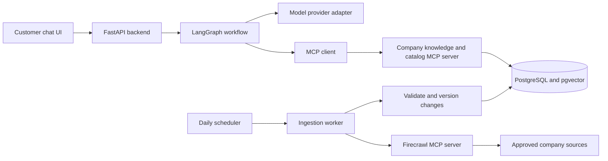

# Provisional architecture and delivery plan

Updated: 2026-10-31. Discovery draft. One fixed company and daily MCP-based ingestion are confirmed directions; company identity and implementation choices remain open. See [requirements](requirements.md) and the [ingestion design](ingestion-and-retrieval.md).

## Product direction

A customer asks company questions or describes what they need. The assistant answers with evidence, asks a focused clarification when essential information is missing, and returns a short product shortlist with reasons and tradeoffs.

Example requests for the IKEA candidate:

- "What is the return policy for an assembled desk?"
- "I need a desk under INR 10,000 that fits a 100 cm space."
- "Show cheaper options while keeping the same size limit."
- "Compare these two desks and explain which meets my requirements."

These are proposed scenarios, not completed functionality.

## Candidate stack

| Layer | Proposal | Reason |
| --- | --- | --- |
| Frontend | React, TypeScript, Vite | Focused chat UI and product cards |
| Backend | Python, FastAPI, Pydantic | Typed API and shared validation |
| Assistant | LangGraph | Explicit state and bounded workflows |
| Integration | Official MCP Python SDK | Real client/server protocol boundary |
| Web ingestion | Firecrawl MCP, subject to source-access and budget spike | Search and scrape through an existing MCP server |
| Model | OpenAI Responses via provider adapter | Structured extraction and grounded synthesis |
| Storage | PostgreSQL with pgvector | Structured products, documents, lexical/vector retrieval |
| Local runtime | Docker Compose; uv and npm lockfiles | Reproducible services and dependencies |
| Checks | pytest; frontend build/typecheck; selected Playwright flows | Verify core behavior and customer journeys |

All entries remain proposals. Avoid additional queues, caches, multiple agents, or a separate vector database unless measured needs justify them.

## Proposed system boundary

The browser holds no model API key. Company facts and product candidates enter the assistant through MCP tools. The backend can access its own session storage; the knowledge/catalog boundary remains demonstrably MCP-based.

Use a fixed backend company profile and market. The ingestion worker can access web tools and staging writes; the customer assistant receives read-only knowledge/catalog tools. Company switching and arbitrary-company discovery are outside scope.

## Workflow

1. Validate the request and session; apply the configured company and market.
2. Classify as company question, recommendation, comparison, mixed, or unsupported.
3. Extract requirements into a typed object and merge explicit follow-up changes.
4. Ask for missing information only when it blocks a useful response.
5. Retrieve company evidence, structured catalog candidates, or both through MCP.
6. Apply deterministic constraints and ranking before generating explanations.
7. Generate a structured answer referencing only returned source IDs and product IDs.
8. Validate facts, constraints, IDs, and citations; return a safe clarification or insufficiency response when validation fails.

Use bounded calls, timeouts, and retries. Application state records requirements, retrieved evidence, and a concise conversation context; it does not store private model reasoning.

## Proposed MCP tools

| Tool | Purpose | Important input/output contract |
| --- | --- | --- |
| `search_company_knowledge` | Retrieve policy and company passages | Query/topic in; excerpts, source IDs, market, dates out |
| `search_products` | Retrieve eligible products | Typed category, price, dimensions, features in; catalog records out |
| `get_product` | Read exact product variant | Validated product ID in; authoritative snapshot fields out |

Use the SDK for discovery and invocation. A protocol test must list and call actual tools; ordinary REST endpoints named "MCP" do not satisfy this requirement. Ingestion also calls the external scraping MCP server through a real MCP client.

## Data and recommendation design

Bootstrap from roughly 30-50 reviewed product variants and 10-15 company/policy documents for one market, if the selected company supports that scope. Then refresh approved sources and discover updates daily. Record source URL, source type, market, publication/update time when available, retrieval time, content hash, and dataset version. Missing attributes remain unknown. See [ingestion and retrieval](ingestion-and-retrieval.md) for incremental publication and failure handling.

Product records need an immutable ID, variant identity, category, price in minor units, currency, normalized dimensions, explicit features, suitability restrictions, and provenance. Distinguish total assembled dimensions from packaging dimensions. Avoid medical or comfort guarantees based on chair marketing.

Company documents use heading-aware chunks and source precedence for conflicting facts. Evaluate PostgreSQL full-text plus pgvector retrieval with rank fusion against a vector-plus-metadata baseline; hybrid retrieval remains a recommendation rather than a hard requirement. A reranker is optional after measuring the baseline. Tune chunk size and retrieval thresholds against labeled examples rather than inventing universal settings.

Recommendations filter hard constraints first: budget, category, physical fit, and required features. Rank eligible items using declared preferences with a documented, testable score. Unknown required attributes cannot be treated as a match. If there are no matches, explain which constraints block results and ask whether to relax one. Never silently exceed budget or dimensions.

Display a dated price and official link. Stock and delivery remain unknown without an authorized live data source. Product price does not imply a delivered total; shipping and assembly costs must be labeled as excluded or unknown when applicable.

## Delivery sequence

| Stage | Work | Exit condition |
| --- | --- | --- |
| 0. Discovery | Select fixed company; resolve audience, deadline, market, budget | Written scope and accepted assumptions |
| 1. Technical spike | Lock compatible SDKs; call scraper MCP on representative company pages; test knowledge MCP and model schema | Protocol roundtrips and usable source extraction |
| 2. Data foundation | Normalize catalog; implement hybrid index, daily discovery and refresh, publication and run tracking | Versioned dataset, repeatable incremental ingestion, observable failures |
| 3. Backend slice | Answer and recommend through graph and MCP; handle follow-ups | Grounded responses and constraint-safe recommendations |
| 4. Interface | Chat, sources, product cards, clarification, loading/error states | End-to-end customer journeys work locally |
| 5. Evaluation and handoff | Run scenarios, fix failures, document setup and limitations | Reproducible demo and recorded evaluation report |

The earlier 6-10 day estimate assumed a curated snapshot. Daily discovery, incremental refresh, and knowledge management expand that scope; re-estimate after the selected company's source-access spike and deadline clarification. No delivery commitment has been made.

## Proposed evaluation and completion gates

Prepare a small labeled set before implementation: approximately 20 company questions, 20 recommendation cases, and 10 follow-up/failure/adversarial cases. Keep some cases held out during tuning. Record dataset/model versions, expected evidence, allowed products, and expected constraints.

- All returned product IDs exist; all hard constraints pass across the evaluation set.
- Company answers have valid evidence links and supported material claims; review support manually, not solely with an LLM judge.
- Unknown facts, conflicting sources, and empty results are handled explicitly.
- Real MCP discovery and invocation pass integration checks.
- Daily ingestion handles unchanged, updated, removed, duplicate, and failed pages correctly; incomplete runs preserve usable published data.
- Prompt injection in retrieved documents cannot grant new tools or override catalog constraints.
- Measure per-request latency, tool failures, token usage, and estimated cost. Set numerical performance and cost budgets after the first measured slice.

Version the evaluation report. Schema compliance and citation presence alone do not prove correctness.

## Operational boundaries

Use read-only, allowlisted tools, parameterized database queries, validated filters, bounded result counts, and separate ingestion credentials. Treat retrieved text as untrusted content. Escape rendered content and allowlist outbound source-link schemes. Isolate sessions, redact logs, and keep secrets out of the repo.

Begin locally. Before public hosting, decide access controls, rate limits, retention, deletion, deployment ownership, and service budgets. Hosting and paid API usage have not been provisioned. Runtime cost depends on model tokens, embeddings, traffic, and hosting; no unsupported monthly price estimate is assumed.

## Next planning deliverables

After company identity and delivery constraints are clarified, refine this draft into concrete API/event schemas, database tables, MCP input/output schemas, source manifests, architecture decisions, and an implementation backlog sized to the deadline.
