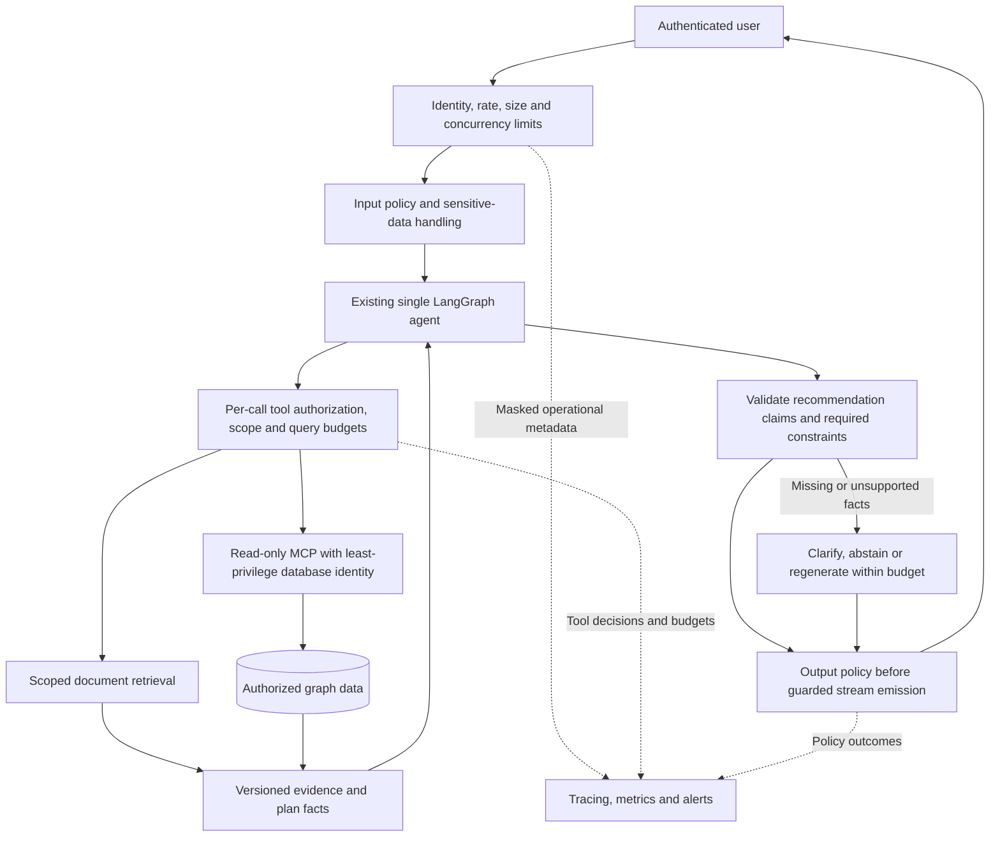

# Production readiness and guardrail plan

**Status: planned hardening, not a production-readiness certification.** The current
application is a working single-host assignment. The controls below distinguish
implemented behavior from work required before exposing it as a production service.
This plan preserves the single-agent architecture; it does not add another agent.

## Current controls and gaps

| Area                     | Implemented today                                                                     | Required before production                                                                                                |
| ------------------------ | ------------------------------------------------------------------------------------- | ------------------------------------------------------------------------------------------------------------------------- |
| Tool permissions         | MCP exposes only get-schema/read-cypher; admin writes use separate endpoints          | Dedicated least-privilege database identities, independently enforced dataset/tenant isolation and bounded query policies |
| Input handling           | Typed requests, bounded messages/uploads and format checks                            | Authenticated sessions, per-user request/token limits, abuse controls and request deadlines                               |
| Prompt injection         | Prompt treats documents/tool results as untrusted and forbids policy overrides        | Executable tool authorization and scope checks; adversarial evaluations; never rely on the prompt as a security boundary  |
| Recommendation grounding | Current published facts, requirement guidance and five hybrid discovery candidates    | Validate structured recommendation claims against plan facts, comparable prices and mandatory constraints                 |
| Output handling          | Safe Markdown rendering; raw HTML/remote images disabled                              | Sensitive-data/output policy checks before content reaches the client; bounded buffers for guarded streaming              |
| Administration           | Shared token, constant-time comparison, optimistic revision checks                    | OIDC/SSO, roles, per-user audit identity and controlled publication permissions                                           |
| Document access          | Published document reads are public                                                   | Explicit organization/tenant access policy before storing private documents                                               |
| Secrets and traces       | SecretStr settings, ignored local secrets, trace masking and optional content capture | Managed secret store/workload identity, rotation, retention and verified export policy                                    |
| Persistence              | Neo4j revisions, local document manifest and process-local chat memory                | Durable checkpoints/state, tenant isolation, backups, restore tests and retention/deletion policies                       |
| Operations               | Provider timeouts, graph recursion bound, logs and correlated Langfuse traces         | Global concurrency/cost limits, health/readiness distinction, alerting and tested recovery                                |
| Delivery                 | Locked dependencies, Ruff, Prettier and automated tests                               | CI enforcement, dependency/secret scanning, reviewed deployment and rollback procedure                                    |

The model currently interprets requirements and writes direct Cypher. Dataset
selection and direct-query result limits are prompt guidance, not a complete
application-enforced authorization policy. MCP read-only mode prevents writes;
it does not by itself prevent reading another dataset or an expensive query.

## Target control placement

The following diagram describes the **production target**, not the current runtime.

## Phase 1 — Identity, secrets and access boundaries

Proposed owners: backend/security and deployment engineering.

- Replace the shared admin token with authenticated identities and explicit read,
  editor and publisher roles. Require authentication/ownership for conversation access.
- Separate database publication credentials from agent read credentials. Retain
  read-only MCP tools, validate required capabilities of the deployed database tier,
  and enforce isolation independently of model-generated WHERE clauses. Use separate
  databases/indexes where isolation cannot be guaranteed by the chosen platform.
- Resolve secrets from deployment-managed configuration; prefer workload identity
  to service-account JSON. Rotate credentials at handover/deployment and define
  rotation/revocation ownership. Keep `.env.example` values secret-free.
- Add secret scanning to local/CI checks. Gitignore protects untracked files only;
  check tracked files and history separately. If a secret was published, revoke it
  first and handle repository history explicitly rather than assuming ignore rules fix it.

Acceptance: unauthorized writes fail; users cannot access another conversation or
dataset; the agent cannot publish even when requested by a user or retrieved text;
credential revocation works; CI rejects a seeded fake-secret fixture used to test
the scanner without exporting actual credentials.

## Phase 2 — Executable agent guardrails

Proposed owners: AI/backend engineering and security review.

- Authorize every tool call, independently of the system prompt. Restrict query
  capabilities/procedures, enforce result/time budgets and dataset access. Prefer
  validated query templates or a robust query-policy boundary where arbitrary
  model-authored Cypher cannot be safely constrained; regex alone is insufficient.
- Treat requirement text, document passages and tool results as untrusted data.
  Evaluate direct/indirect prompt injection and data-exfiltration attempts against
  the actual four-tool workflow. A classifier may assist, but cannot grant access.
- Have the agent produce structured recommendation claims referencing stable
  product/plan IDs and revisions. Check capacity, included features, price currency,
  period/unit and current publication against authoritative facts before presenting
  a plan as eligible. Distinguish preferences from mandatory constraints.
- Define output rules for secrets, personal data, unsupported claims and unsuitable
  requests. For streaming, validate bounded chunks or buffer the answer before
  release when the policy needs the whole response. Validation after a completed
  stream cannot retract text already displayed.
- On policy failures, return an explicit safe response, ask a clarification or retry
  within a small bounded budget. Preserve correlation IDs without returning raw
  provider errors or internal reasoning.

Acceptance: injected evidence cannot widen tool access; disallowed/expensive reads
are blocked; invalid billing-unit comparisons and unsupported capabilities cannot
be presented as verified facts; rejected sensitive content never appears in SSE;
uncertain facts produce clarification/abstention, not invented evidence.

## Phase 3 — Retrieval, scale and lifecycle

Proposed owners: AI/data engineering and application operations.

- Evaluate semantic discovery with a representative catalog and judged requirement
  queries. Measure recall@5, constraint satisfaction, evidence accuracy and latency;
  agree targets from the deployment's actual requirements rather than inventing a
  success percentage. Include exact lookups, multi-hop comparisons and no-fit cases.
- Isolate indexes by dataset/model where needed and measure the effect of filtering
  after bounded source retrieval. Test top-five discovery with more than 1,000 nodes;
  the current 20-product live check is not proof of scale or recommendation quality.
- Add idempotent indexing jobs/backpressure when publication volume exceeds the
  synchronous assignment flow. Version embedding configuration and support migration
  and rollback without mixing incompatible vectors.
- Move checkpoints and publication manifests to durable coordinated persistence
  before running multiple application workers. Define conversation TTL, retention,
  deletion, backups and restore drills. Preserve revision/concurrency guarantees.

Acceptance: benchmark results are reproducible and reviewed; concurrent publication
cannot expose stale facts; restart/failover retains intended state; backup restore
and deletion behavior are verified with test data.

## Phase 4 — Service operations and release gates

Proposed owners: deployment engineering, QA and the service owner.

- Put TLS, identity, rate limits and request-size limits at the service boundary.
  Enforce maximum concurrent conversations, overall turn deadlines, tool rounds,
  output tokens and per-user/model spend budgets; the graph recursion limit alone
  is not a cost policy. Cancel provider/tool work when a client disconnects.
- Separate liveness from dependency readiness. Monitor availability, provider error
  rate, time to first token, full-turn latency, retrieval misses, policy failures
  and usage. Configure alerts and owned incident/rollback procedures.
- Keep trace content capture off by default for production. Approve any content
  export, access, masking and retention policy; test masking at the export boundary.
  Review whether data may be sent to each external model/observability service.
- Enforce locked installs, test/lint/build checks, dependency and secret scanning,
  migration checks and a staged release/rollback run in CI. Record actual evidence.
- Replace the synthetic assignment catalog with authorized business data before
  representing the service as a source of real commercial product/price claims.

Release gate: all above acceptance evidence has an owner and reviewer; outstanding
risks are explicitly accepted by the service owner. Do not label the application
production-ready based only on UI completion, prompt rules or passing unit tests.

## What this repository update changes

Review references: [API authorization](../src/company_compass/api/dependencies.py),
[chat routes](../src/company_compass/api/routes/assistant.py),
[thread state](../src/company_compass/agents/assistant.py),
[streaming workflow](../src/company_compass/agents/workflow.py),
[MCP configuration](../src/company_compass/integrations/mcp_client.py) and
[service credentials](../src/company_compass/core/container.py).
This bounded review did not run a dependency vulnerability scan or a deployment
penetration test; those remain release gates rather than claimed verification.

The production work above is planned. This update improves environment-file hygiene,
the public configuration template, editor conventions and documentation. It does
not silently install a guardrail framework, add identity/rate-limit infrastructure,
rewrite native MCP tools or claim those controls are implemented.
